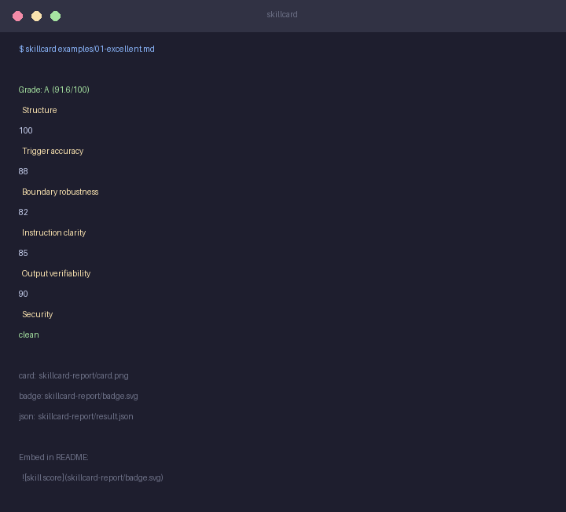
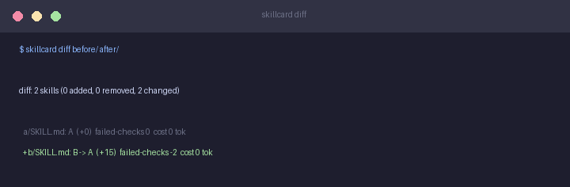

# skillcard

[](https://github.com/6xy16/skillcard/actions/workflows/test.yml)
[](LICENSE)


A quality score card for Agent Skills. Point it at a `SKILL.md` and it scores it
four ways, renders a shareable grade card, and tells you exactly what to fix next.

```console
$ skillcard examples/01-excellent.md
```



The card it produces:


---

## What it does

skillcard is a four-layer evaluation pipeline, from deterministic linting to
actually running the skill:

| Layer | What it checks | Runs |
|-------|----------------|------|
| **L1 Structure** | 10 deterministic checks — frontmatter, core fields, description quality, trigger clarity, examples, size, output spec | always |
| **L2 Paper review** | an LLM judge scores 4 dimensions from auto-generated probes | with an API key |
| **L3 Security gate** | scans for prompt-injection / judge-gaming patterns and caps the grade | always |
| **L4 Execution** | runs the skill's code in a subprocess, records completion / duration / output | with `--run` |

Plus the engineering workflow around it: batch a directory, diff two versions,
cache LLM verdicts, and measure how much the judge's score wiggles.

---

## Real output, real numbers

Everything below is a real run against DeepSeek (`deepseek-chat`), not a mock.

**A well-written skill** (`examples/01-excellent.md` — a code reviewer):

```console
$ skillcard examples/01-excellent.md

Grade: A  (91.6/100)
  Structure              100
  Trigger accuracy       88
  Boundary robustness    82
  Instruction clarity    85
  Output verifiability   90
  Security               clean

card:  skillcard-report/card.png
badge: skillcard-report/badge.svg
json:  skillcard-report/result.json
```

**A mid skill** (`examples/02-okay.md` — a bare git helper) scores **D (68/100)**
because it has no examples, no output spec, and weak trigger guidance. That gap
is exactly what the improvement list points at.

Three files land in `./skillcard-report/`:

| File | What it is |
|------|------------|
| `card.png` | grade card with the letter grade, dimension bars, and security status |
| `badge.svg` | static badge to embed in your README |
| `result.json` | full machine-readable result — judge model, prompt hash, probes, raw verdict, token cost, and latency for reproducibility |

Embed the badge in your README:

```md

```

---

## Install

```bash
pip install git+https://github.com/6xy16/skillcard.git
```

## Usage

```bash
# Basic run (L1 + L3, no API key needed)
skillcard path/to/SKILL.md

# Skip the LLM review explicitly
skillcard path/to/SKILL.md --no-llm

# Also execute the skill's code (L4, unsafe — see below)
skillcard path/to/SKILL.md --run

# Custom output directory / JSON to stdout
skillcard path/to/SKILL.md --out my-report --json
```

Enable the L2 LLM review — install the extra, then point it at any
OpenAI-compatible endpoint:

```bash
pip install "skillcard[llm] @ git+https://github.com/6xy16/skillcard.git"
export SKILLCARD_API_KEY=sk-...
export SKILLCARD_MODEL=deepseek-chat        # or gpt-4o-mini, etc.
export SKILLCARD_BASE_URL=https://...       # any OpenAI-compatible endpoint
```

---

## Batch, diff, and stability

Single-file scoring is the demo. The engineering loop is the point:

```bash
# Evaluate every SKILL.md under a directory
skillcard batch ./skills --out before/

# ... edit some skills ...

# Re-evaluate and diff: what moved?
skillcard batch ./skills --out after/
skillcard diff before/ after/
```



- **`batch`** writes one JSON per skill (plus a summary) so the snapshot is
  diffable and reproducible in CI.
- **`diff`** reports, per skill, the score delta, grade change, failed-check
  change, and token-cost change — regressions first.

LLM verdicts are cached on disk keyed on skill text + model + prompt hash, so
re-running an unchanged skill is free and bit-stable:

```console
$ skillcard examples/02-okay.md     # first run: 3.4s, 1013 tokens
$ skillcard examples/02-okay.md     # cached:   0s, 0 tokens (served from disk)
```

And because LLM judging is non-deterministic, `stability` re-runs the judge N
times to tell you whether a score is a signal or noise:

```console
$ skillcard stability examples/01-excellent.md --runs 3

Stability: code-reviewer  (model: deepseek-chat)
runs: 3, successful: 3

  trigger_accuracy       mean=88.0 ±0.0  range=[88, 88]
  boundary_robustness    mean=82.0 ±0.0  range=[82, 82]
  instruction_clarity    mean=82.7 ±4.0  range=[78, 85]
  output_verifiability   mean=88.3 ±2.9  range=[85, 90]

  tokens/run:  mean=1354  range=[1316, 1389]
  latency/run: mean=3.63s
```

Note the spread: `trigger_accuracy` and `boundary_robustness` are rock-stable,
while `instruction_clarity` moves by ±4 points. That's the kind of detail you
need before you trust any single score.

---

## How it works

### L1 — Structure (deterministic, always on)
10 checks: frontmatter validity, core fields, description length (CJK-aware),
vague words, trigger clarity, examples, size, recommended fields, structured
body, output verifiability.

### L2 — Paper review (LLM judge, optional)
Generates 10 probe requests (should-trigger / borderline / should-not-trigger)
and scores 4 dimensions: trigger accuracy, boundary robustness, instruction
clarity, output verifiability. Scores are strictly validated (numeric, 0–100);
missing or out-of-range fields become `n/a` instead of a bogus default.

### L3 — Security gate (always on)
Scans for prompt-injection and judge-gaming patterns. It's not a scored
dimension, it's a gate:

- 0 hits → grade is whatever your quality score says
- 1 hit → grade capped at B
- 2 hits → grade capped at D
- 3+ hits → F

A high quality score can't buy back a security hit.

### L4 — Dynamic execution (optional, `--run`)

L1/L2/L3 only *read* the skill. L4 runs it: the skill's code blocks are written
to a temp script and executed in a local subprocess with a hard timeout and an
output cap, recording whether the run completed, how long it took, and what it
emitted. This closes the loop from static check → paper review → actual
execution.

> **Security warning.** Running a SKILL.md executes arbitrary, untrusted
> instructions on your machine. The subprocess boundary gives you a timeout
> and an output cap, but **no filesystem, network, or environment isolation**.
> Only run skills you trust. For untrusted skills, run skillcard inside a
> disposable VM or container.

---

## Benchmark

`benchmarks/` holds a small, open, hand-annotated trigger benchmark: a few
good / mid / poor skills, each paired with user requests labeled
`trigger` / `no_trigger` / `borderline`.

```bash
python benchmarks/benchmark.py
```

It compares a deterministic (lexical-overlap) approximation against those
labels and reports accuracy and false-positive / false-negative rates. It's
deliberately a *baseline*, not a leaderboard: the approximation is simple,
reads only the skill's self-description, and the sample is small. The point is
a re-runnable, diffable number that a real agent-based scorer must beat — see
[`benchmarks/report.md`](benchmarks/report.md) for the current result and
limitations.

---

## Grades

`A (90+)  B (80+)  C (70+)  D (60+)  F (<60)` — the letter grade is the main visual on the card.

---

## Roadmap

- **v0.1** — static checks + paper review, PNG card, static badge, improvement suggestions
- **v0.2** — L4 execution, batch + diff, LLM cache + stability, trigger benchmark
- **v0.3** — dynamic badge endpoint, multi-model comparison, opt-in leaderboard

---

## Contributing

Bug reports and pull requests are welcome. See [CONTRIBUTING.md](CONTRIBUTING.md)
for the local development setup and how to add a new check. For security
issues, see [SECURITY.md](SECURITY.md).

---

## License

MIT
