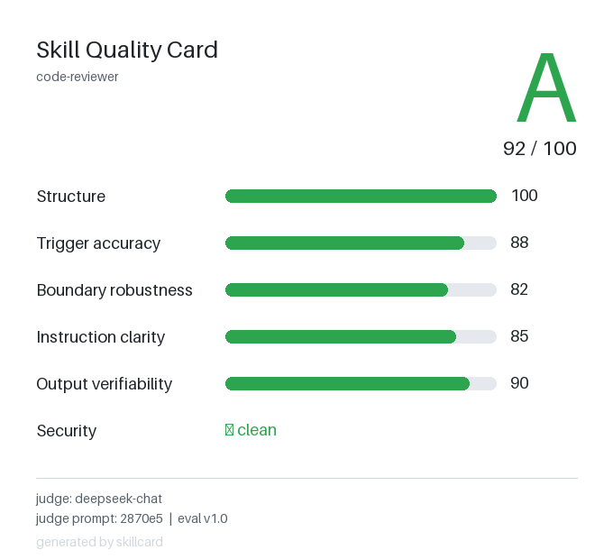

# skillcard

[](https://github.com/6xy16/skillcard/actions/workflows/test.yml)


Generate a score card and a README badge for a Skill's `SKILL.md`, along with a list of what to fix next.



---

## What you get

```
$ skillcard examples/01-excellent.md

Grade: A  (100.0/100)
  Structure              100
  Trigger accuracy       n/a
  Boundary robustness    n/a
  Instruction clarity    n/a
  Output verifiability   n/a
  Security               clean

card:  skillcard-report/card.png
badge: skillcard-report/badge.svg
json:  skillcard-report/result.json
```

Three files land in `./skillcard-report/`:

| File | What it is |
|------|------------|
| `card.png` | 680×620 score card with the letter grade, dimension bars, and security status |
| `badge.svg` | static badge for your README |
| `result.json` | machine-readable result, including the judge model and prompt hash for reproducibility |

Embed the badge in your README:

```md

```

---

## Install

```bash
pip install git+https://github.com/6xy16/skillcard.git
```

## Usage

```bash
# Basic run (L1 structure + L3 security gate)
skillcard path/to/SKILL.md

# Skip LLM review explicitly
skillcard path/to/SKILL.md --no-llm

# Custom output directory
skillcard path/to/SKILL.md --out my-report

# Print JSON to stdout
skillcard path/to/SKILL.md --json
```

Enable L2 LLM paper review (optional). Install the LLM dependency, then configure the endpoint:

```bash
pip install "skillcard[llm] @ git+https://github.com/6xy16/skillcard.git"
export SKILLCARD_API_KEY=sk-...
export SKILLCARD_MODEL=gpt-4o-mini        # optional
export SKILLCARD_BASE_URL=https://...     # optional, any OpenAI-compatible endpoint
```

---

## How it works

There are three layers:

### L1 — Structure (deterministic, always on)
10 checks: frontmatter validity, core fields, description length (CJK-aware), vague words, trigger clarity, examples, size, recommended fields, structured body, output verifiability.

### L2 — Paper review (LLM judge, optional)
Generates 10 probe requests (should-trigger / borderline / should-not-trigger) and scores 4 dimensions: trigger accuracy, boundary robustness, instruction clarity, output verifiability.

### L3 — Security gate (always on)
Scans for prompt-injection and judge-gaming patterns. It's not a scored dimension, it's a gate:

- 0 hits → grade is whatever your quality score says
- 1 hit → grade capped at B
- 2 hits → grade capped at D
- 3+ hits → F

A high quality score can't buy back a security hit.

---

## Why

There are a lot of skills out there and no shared quality bar. Existing tools are mostly internal linters aimed at developers. skillcard takes a different angle: the output is meant to be shared, not just consumed — a card worth posting, a badge worth embedding, and a concrete list of what to improve next.

---

## Grades

`A (90+)  B (80+)  C (70+)  D (60+)  F (<60)` — the letter grade is the main visual on the card.

---

## Roadmap

- **v0.1** — static checks + paper review, PNG card, static badge, improvement suggestions
- **v0.2** — real agent runs, dynamic badge endpoint, multi-model comparison
- **v0.3** — batch scoring, diff between versions, opt-in leaderboard

---

## Contributing

Bug reports and pull requests are welcome. See [CONTRIBUTING.md](CONTRIBUTING.md) for the local development setup and how to add a new check. For security issues, see [SECURITY.md](SECURITY.md).

---

## License

MIT
